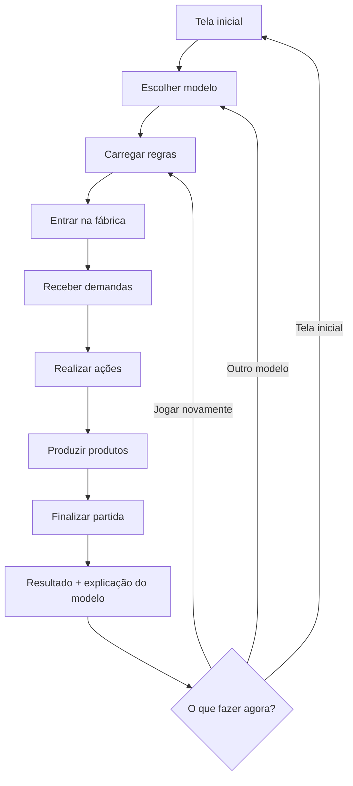
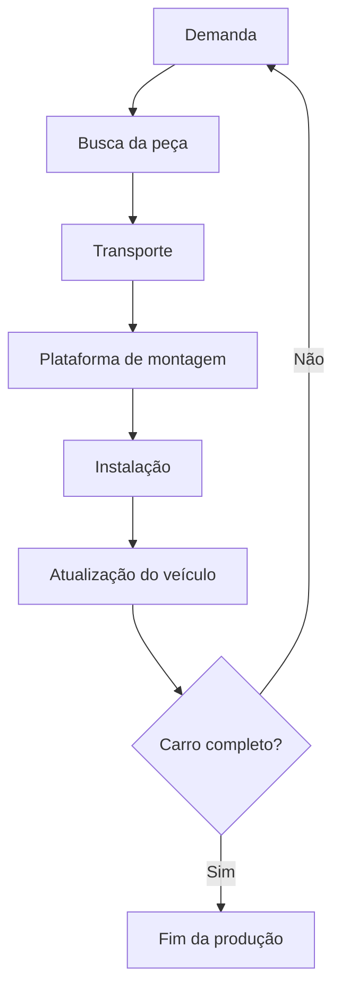
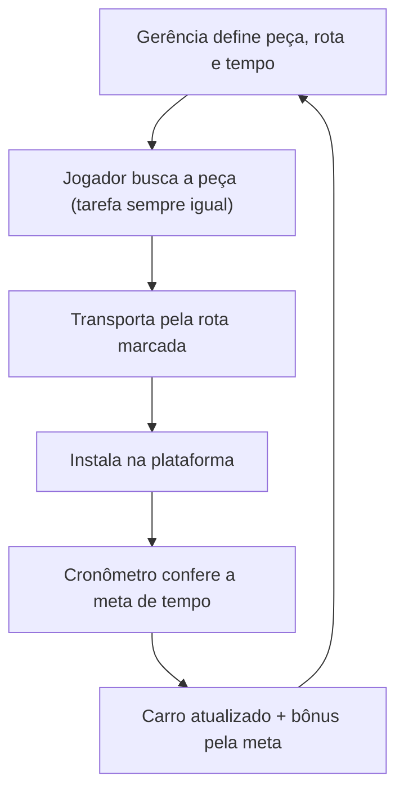
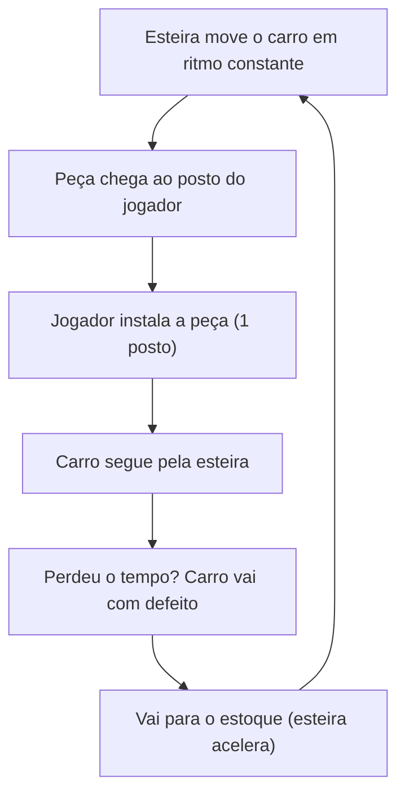
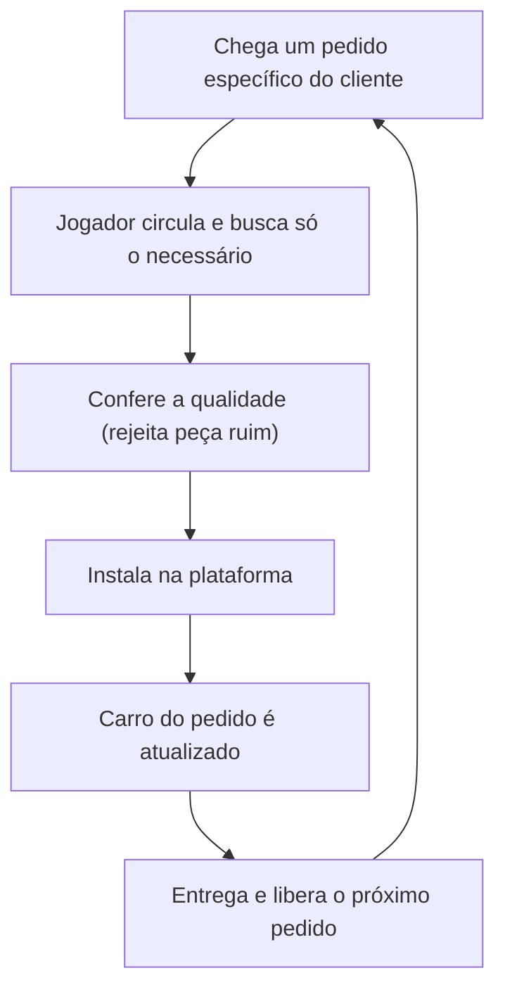
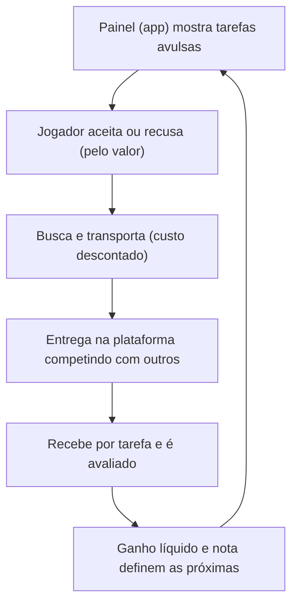

<div align="center">

# 🏭 Mundo SENAI

**Jogo 2D que coloca você na pele de um funcionário de fábrica para vivenciar, na prática, os modelos de produção estudados em Sociologia.**


</div>

---

## 📑 Índice

- Sobre o projeto
- Modelos de produção
- Como o jogo funciona
- Fluxo de produção do veículo
- O fluxo em cada modelo
- Comparação entre os modelos
- Tecnologias
- Estrutura de pastas
- Como executar
- Status e próximos passos
- Fluxo de trabalho com Git

---

## 🎯 Sobre o projeto

No **Mundo SENAI**, o jogador assume o papel de um funcionário dentro de uma **fábrica automotiva** e participa da montagem de um veículo. O objetivo é sempre o mesmo: **montar o carro de acordo com as demandas recebidas**.

O que muda é **como o trabalho é organizado**. Antes de começar, o jogador escolhe um modelo de produção, e cada modelo tem regras próprias de ritmo, tarefas, demanda e autonomia. Ao final da partida, o jogo mostra o resultado e **explica o modelo**, ligando o que aconteceu na prática ao conteúdo de Sociologia.

> 💡 A ideia central: ao jogar o mesmo objetivo de formas diferentes, o jogador percebe que **a organização do trabalho não é igual em todos os modelos**.

---

## 🏷️ Modelos de produção

| Modelo | Ideia em uma linha |
|---|---|
| **Taylorismo** | O trabalho é planejado pela gerência e cronometrado; o trabalhador só executa uma tarefa fixa. |
| **Fordismo** | A esteira dita o ritmo; a produção é em série, padronizada e em grande escala. |
| **Toyotismo** | A demanda puxa a produção, o estoque é mínimo e o trabalhador é polivalente. |
| **Uberização** | O trabalho vem em tarefas avulsas por plataforma digital; riscos e custos ficam com o trabalhador. |

---

## 🎮 Como o jogo funciona



<details>
<summary><b>Ver o passo a passo de cada etapa</b></summary>

1. **Início:** a tela inicial apresenta o título, uma breve descrição, instruções básicas e as quatro opções de modelo.
2. **Seleção do modelo:** o sistema identifica o modelo escolhido e carrega as configurações correspondentes.
3. **Entrada no cenário:** o jogador é inserido no cenário 2D da fábrica, já no papel de funcionário.
4. **Início da produção:** as demandas aparecem e o jogador realiza as ações necessárias, de acordo com as regras do modelo.
5. **Interação:** as interações são simples e representam atividades de trabalho; a quantidade e o tipo de ações mudam conforme o modelo.
6. **Acompanhamento:** informações da partida ajudam a entender a produção e a comparar os modelos.
7. **Finalização:** a partida termina quando a condição definida para aquele modelo é atingida.
8. **Explicação:** o jogador recebe o resultado e uma explicação do modelo, conectando a experiência ao conteúdo sociológico.
9. **Próxima experiência:** jogar novamente, escolher outro modelo ou voltar à tela inicial.

</details>

### 🏗️ Elementos do cenário

- Personagem do jogador
- Área de produção
- Máquinas e objetos
- Entrada de demandas
- Produtos
- Estoque ou saída
- Informações da partida

### 📊 Informações exibidas durante a partida

- Demanda recebida
- Produtos produzidos
- Produtos entregues
- Estoque
- Tempo de partida
- Desempenho do funcionário

---

## 🚗 Fluxo de produção do veículo

A produção é baseada na **montagem de um veículo**. No início da partida, o carro está incompleto em uma **plataforma de montagem**. Ao redor da fábrica há áreas com peças específicas: o jogador deve **localizar, adquirir e transportar** cada peça até a plataforma, onde ela é instalada.

A plataforma é o principal indicador visual do progresso: a cada peça instalada, o carro muda de aparência, até ficar completo.



A diferença entre os modelos está em **como esse fluxo é realizado**: obtenção das peças, deslocamento, tempo de produção, qualidade dos componentes, organização das tarefas e atendimento da demanda.

---

## 🔀 O fluxo em cada modelo

> ⚠️ **Proposta inicial.** As regras definitivas serão estabelecidas após a pesquisa e a validação do conteúdo com o professor.

<details open>
<summary><b>🔵 Taylorismo: tudo planejado e cronometrado</b></summary>

<br>

Baseado na administração científica, separa quem **planeja** (a gerência) de quem **executa** (o trabalhador), com tarefas divididas ao máximo e tempos controlados por cronômetro.



**Como funciona no jogo**

- O jogador executa **uma única tarefa fixa**, repetidamente (por exemplo, buscar e instalar sempre a mesma peça).
- O sistema dita tudo: qual peça, qual rota e quanto tempo. O jogador não escolhe nada.
- Um **cronômetro** fica visível durante toda a partida, e há bônus por bater a meta de tempo.
- A demanda é planejada previamente pela gerência.

**O que o jogador deve perceber:** a produtividade é alta, mas o trabalho é repetitivo e sem autonomia; o planejamento fica com a gerência e o trabalhador apenas executa.

</details>

<details>
<summary><b>🟠 Fordismo: a esteira dita o ritmo</b></summary>

<br>

Baseado na linha de montagem: o trabalho vem até o trabalhador, o ritmo é imposto pela esteira e a produção é em série, padronizada e em grande escala.



**Como funciona no jogo**

- A plataforma funciona como uma **esteira que se move sozinha**: o carro passa pelo posto do jogador e a peça chega até ele.
- Se o jogador não instalar a peça a tempo, o carro segue incompleto e conta como **defeito**.
- A esteira **acelera** ao longo da partida.
- Produz-se sempre o mesmo carro, **sem olhar a demanda**: o estoque cresce e pode lotar.

**O que o jogador deve perceber:** o ritmo deixa de ser definido por um cronômetro e passa a ser imposto pela máquina, e a produção em massa pode gerar excesso de estoque.

</details>

<details>
<summary><b>🟢 Toyotismo: produz só o que foi pedido</b></summary>

<br>

Baseado na produção enxuta e no *just-in-time*: a demanda **puxa** a produção, o estoque é mínimo e o trabalhador é polivalente e responsável pela qualidade.



**Como funciona no jogo**

- A demanda chega como um **pedido específico** (por exemplo, um carro com determinadas características), e só se produz o que foi pedido.
- O jogador é **polivalente**: circula por várias áreas e realiza várias funções.
- Ele também **confere a qualidade** das peças e pode rejeitar a peça defeituosa e até parar a linha.
- O estoque é mínimo: peça sobrando é desperdício e gera penalidade.

**O que o jogador deve perceber:** há mais flexibilidade e mais qualidade, mas também mais responsabilidade e cobrança sobre o trabalhador, que passa a fazer várias funções.

</details>

<details>
<summary><b>🟣 Uberização: o algoritmo manda, o trabalhador banca o risco</b></summary>

<br>

Baseada no trabalho sob demanda por plataformas digitais: o trabalhador é tratado como autônomo, sem vínculo fixo, enquanto as tarefas são distribuídas e avaliadas por um algoritmo.



**Como funciona no jogo**

- **Não há posto fixo nem chefe visível.** O jogador acessa um painel (semelhante a um aplicativo) com tarefas avulsas, cada uma com um valor, e decide se aceita ou recusa.
- O pagamento é **por tarefa**, sem salário fixo e sem pagar o tempo de espera.
- Os **custos** (como deslocamento e energia) ficam por conta do jogador e são descontados do ganho.
- Outros trabalhadores (personagens controlados pelo jogo) **disputam as mesmas tarefas**, e o valor cai quando há muita concorrência.
- Uma **nota de avaliação** define quais tarefas aparecem para o jogador, e uma nota baixa pode levar ao **bloqueio**.
- O carro é montado por muitos trabalhadores ao mesmo tempo, e o jogador é facilmente substituível.
- Ao final, a tela de resultado mostra o **ganho bruto e o líquido por hora trabalhada**, sem férias, sem seguro e sem garantia de novas tarefas.

**O que o jogador deve perceber:** a liberdade de aceitar ou recusar tarefas é aparente; os riscos e os custos ficam com o trabalhador, enquanto a plataforma controla a distribuição e a avaliação.

</details>

---

## ⚖️ Comparação entre os modelos

| Modelo | Quem dita o ritmo | O que o jogador faz | Demanda e estoque | Autonomia |
|---|---|---|---|---|
| **Taylorismo** | Cronômetro e gerência | Uma tarefa fixa e repetitiva | Planejada previamente | Nenhuma |
| **Fordismo** | Esteira (a máquina) | Um posto na linha de montagem | Produz em série, sem olhar o pedido; o estoque cresce | Muito baixa |
| **Toyotismo** | Pedido do cliente | Várias funções e controle de qualidade | Puxada pelo pedido; estoque mínimo | Média, com mais cobrança |
| **Uberização** | Algoritmo e concorrência | Tarefas avulsas, por conta própria | Tarefas avulsas distribuídas pelo painel | Aparente; riscos e custos ficam com o trabalhador |

---

## 🛠️ Tecnologias

| Tecnologia | Para que serve no projeto |
|---|---|
| **HTML5** | Estrutura das páginas e dos elementos do jogo: tela inicial, botões, áreas do cenário, informações da partida e demais componentes da interface. |
| **CSS3** | Identidade visual e aparência: cores, posicionamento, organização das telas, animações e elementos visuais do cenário 2D. |
| **JavaScript** | Linguagem principal do jogo: interações do jogador, movimentação, sistema de demandas, produção, regras de cada modelo, pontuação e demais comportamentos. |
| **JSON** | Dados e configurações do jogo (modelos de produção, configurações das partidas, textos), evitando concentrar tudo nos arquivos JavaScript. |
| **Git e GitHub** | Controle de versões e hospedagem do repositório, facilitando o trabalho colaborativo da equipe. |
| **Recursos gráficos** | Personagens, cenário, objetos da fábrica e ícones, desenvolvidos ou organizados pelo integrante responsável pelo Design e integrados via HTML, CSS e JavaScript. |

---

## 📁 Estrutura de pastas

```text
Mundo-SENAI/
│
├── index.html
│
├── pages/
│   └── jogo.html
│
├── CSS/
│   ├── reset.css
│   ├── inicio.css
│   ├── jogo.css
│   └── componentes.css
│
├── JS/
│   ├── main.js
│   ├── jogo.js
│   ├── fabrica.js
│   ├── jogador.js
│   ├── demanda.js
│   ├── producao.js
│   │
│   └── modelos/
│       ├── taylorismo.js
│       ├── fordismo.js
│       ├── toyotismo.js
│       └── uberizacao.js
│
├── JSON/
│   └── modelos.json
│
├── assets/
│   ├── imagens/
│   ├── personagens/
│   ├── cenarios/
│   ├── icones/
│   └── audio/
│
└── README.md
```

| Item | Função |
|---|---|
| `index.html` | Tela inicial e seleção do modelo de produção. |
| `pages/jogo.html` | Estrutura da tela principal do jogo. |
| `CSS/` | Arquivos responsáveis pela estilização. |
| `JS/` | Arquivos responsáveis pela lógica e funcionamento. |
| `JS/modelos/` | Regras específicas de cada modelo de produção. |
| `JSON/` | Dados e configurações do jogo. |
| `assets/` | Recursos visuais e sonoros. |
| `README.md` | Documentação geral do projeto. |

---

## ▶️ Como executar

> Esta seção vale a partir da primeira versão jogável.

O projeto é estático (HTML, CSS e JavaScript), mas como o jogo vai ler arquivos **JSON**, abra-o por um servidor local. Abrir o `index.html` direto no navegador (`file://`) costuma bloquear a leitura desses arquivos.

```bash
# clonar o repositório
git clone <url-do-repositorio>
cd Mundo-SENAI

# opção 1: Python
python3 -m http.server 8000

# opção 2: Node
npx serve .
```

Depois, acesse `http://localhost:8000` no navegador. No VS Code, a extensão **Live Server** também resolve.

---

## 🚧 Status e próximos passos

O projeto está em **fase de planejamento**.

- [x] Definição das tecnologias
- [x] Definição da estrutura de pastas
- [x] Definição do fluxo geral do jogo
- [x] Proposta de fluxo para cada modelo
- [x] Pesquisa e validação do conteúdo de Sociologia com o professor
- [ ] Definição das regras definitivas de cada modelo
- [ ] Criação dos recursos gráficos (personagens, cenário, objetos e ícones)
- [ ] Primeira versão jogável
- [ ] Tela de resultado e explicação de cada modelo

---

## 🌿 Fluxo de trabalho com Git

Sugestão para a equipe trabalhar sem sobrescrever o código uns dos outros:

1. Mantenha a branch `main` sempre estável.
2. Crie uma branch para cada tarefa, por exemplo `feature/modelo-taylorismo` ou `feature/tela-inicial`.
3. Faça commits pequenos e com mensagens claras (`adiciona cronômetro do Taylorismo`).
4. Abra um **Pull Request** para a `main` e peça que outro integrante revise antes de aprovar.
5. Antes de começar a trabalhar, atualize sua cópia com `git pull`.